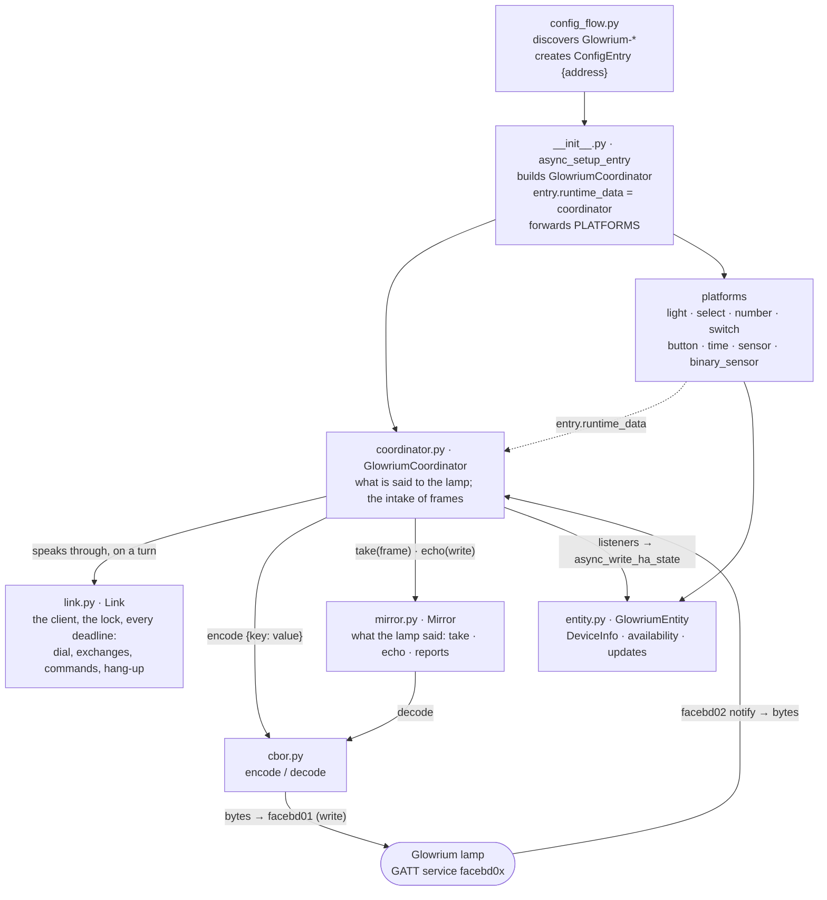

# Architecture

This document explains how the **Glowrium** Home Assistant integration is put
together and how it talks to the lamp over Bluetooth Low Energy. It is written
for contributors who want to understand the internals or add support for another
model in the Glowrium grow-light family (G2–G10).

For installation and day-to-day usage, see the [README](README.md). For the
step-by-step contribution workflow, see [CONTRIBUTING.md](CONTRIBUTING.md).

The BLE protocol was reverse-engineered from the official `com.inledco.glowrium`
Android app (btsnoop captures) and verified against real hardware. Everything is
**local** — no cloud, no vendor account, no BLE bond/pairing.

---

## High-level overview

The integration is a thin, active BLE client. One **coordinator** stands for one
lamp: its **link** (`link.py`) owns the connection, the coordinator mirrors the
device's state and exposes control methods, and Home Assistant entities are
stateless views over that coordinator.

- **Transport:** a vendor GATT service (`facebd0x-…`, advertised as *"rabbit iot
  ble"*). Commands are **CBOR** maps written to one characteristic; state arrives
  as CBOR notifications on another.
- **State model:** the device is a bag of integer-keyed properties (`0x06` =
  power, `0x08` = brightness, …). The last-known value of each is kept in the
  state mirror (`mirror.py`), a read-only mapping the coordinator exposes as
  `state`, filled from the lamp's notifications and from the echo of what was
  written to it.
- **Entities:** `light`, `select`, `number`, `switch`, `button`, `time`,
  `sensor`, `binary_sensor` — each reads a property through the coordinator and
  calls a `coordinator.async_set_*` method to write.
- **No polling for state.** `iot_class` is `local_push`: the lamp pushes state
  via notify, and entities re-render from a coordinator listener callback. The
  keeper's 30-second tick is for the link, not the state: it rebuilds one
  that was lost, and asks one that has been silent for five minutes whether it
  is still there (see [Reconnect](#reconnect)).

### File map

| File (`custom_components/glowrium/…`) | Responsibility |
| --- | --- |
| `__init__.py` | `async_setup_entry` / `async_unload_entry` / `async_remove_entry`; builds the coordinator with its keeper and its dial, stores it in `entry.runtime_data`, forwards platforms, has the coordinator hang up when Home Assistant stops, keeps for each lamp what could not be closed, and takes the notice about unconfirmed presets down when an entry is removed |
| `config_flow.py` | Bluetooth auto-discovery + manual picker for `Glowrium-*` devices |
| `coordinator.py` | The device: the intake of frames into the mirror, all command methods, the clock, activation, the telling of the entities - and what is said to the lamp: the first exchange on a link, the question for a silent one, each command. It is handed no Home Assistant: what it needs of whatever runs it, it asks of its keeper (`Keeper`, declared here) |
| `keeper.py` | What keeps a coordinator in Home Assistant, for one config entry (`EntryKeeper`): both lifetimes of background work, the three watchers, the repair for a stack that will not hang up, the notice about unconfirmed presets, the device registry, the remembered model id, the home's coordinates - and the dial to the lamp as Home Assistant's Bluetooth finds it (`dial_for`) |
| `mirror.py` | The state mirror: what the lamp has said, frame by frame, and what was written to it, as a read-only mapping. Takes a frame - never raises; the decoder's outcomes, their log lines and the blanking of a printed frame are its - counts the reports and what each carried, dates the lamp's clock |
| `link.py` | The link: the client and the lock around it, the dial, the hang-up and the closing of the client's bus, the stack that will not hang up, whether the lamp is in reach - and when the lamp is spoken to: the background connect, the first exchange, the question for a silent link, the delivery of a command with its one retry, and every deadline. No client leaves it. No Home Assistant in it and no protocol |
| `cbor.py` | Minimal CBOR encoder/decoder (only the subset the device uses) — the *wire* format |
| `protocol.py` | Semantic codec — one reader for each property, which says what its value is, or that nothing was reported, or that what was reported cannot be used; the byte layouts (`0x11` slot, `0x2f` ramp, `0x35` daylight saving, `0x05` clock) read and written; the coordinator's typed accessors and setters delegate here |
| `const.py` | GATT UUIDs, CBOR property keys, the list of what gives the lamp's place away, mode constants |
| `models.py` | Per-model registry (name, lighting-mode presets) keyed by `pkey` |
| `diagnostics.py` | The diagnostics download: what the coordinator knows, rebuilt from what it read, with nothing in it the lamp chose |
| `identity.py` | What is shown of the lamp's own words about itself: its advertised name as text, its model id and firmware only in the shape each claims to have |
| `entity.py` | `GlowriumEntity` base — `DeviceInfo`, availability, update fan-out |
| `light.py` `select.py` `number.py` `switch.py` `button.py` `time.py` `sensor.py` `binary_sensor.py` | Platform entities |
| `strings.json`, `translations/`, `icons.json` | UI text (entity and preset names, errors, the repairs), and entity icons |
| `manifest.json` | Domain, Bluetooth matcher (`local_name: Glowrium-*`), requirements |
| `brand/` | The integration's icon, as Home Assistant shows it |
| `quality_scale.yaml` | Where the integration says how it stands against Home Assistant's quality scale |

The three modules that write to the log each do so under their own name -
`custom_components.glowrium.link`, `.mirror`, `.coordinator` - so a line says
which of them wrote it.

---

## Data flow



1. **`config_flow.py`** finds devices whose advertised name starts with
   `Glowrium` (auto-discovered via the manifest Bluetooth matcher, or picked from
   a list) and creates a config entry holding just the BLE `address`.
2. **`__init__.py` · `async_setup_entry`** constructs a `GlowriumCoordinator`,
   calls `async_start()` (which begins watching for and connecting to the lamp),
   stashes it in `entry.runtime_data`, and forwards the config entry to every
   platform.
3. **Each platform** reads `entry.runtime_data` (the coordinator) and registers
   its entities. Entities subclass `GlowriumEntity`.
4. **Reads:** an entity asks the coordinator for a property by what it means,
   and never looks under an id for itself: each accessor is a reader of
   `protocol.py` over the mirror, and answers a value, nothing, or that what
   the lamp reported cannot be used (see [What a value is](#what-a-value-is)).
   **Writes:** entity commands call `coordinator.async_set_*`, which
   CBOR-encodes a map and writes it to the lamp.
5. **Notifications** decoded from the lamp update `coordinator.state`; the
   coordinator then calls its listeners, and each entity re-renders via
   `async_write_ha_state()`.

---

## GATT transport

All control happens over one vendor service, `facebd00-7261-6262-6974-696f74626c65`
(the ASCII tail spells `rabbit iot ble`). UUIDs are defined in `const.py`.

| Characteristic | Const | Direction | Purpose |
| --- | --- | --- | --- |
| `facebd01-…` | `WRITE_UUID` | Write | **Commands.** Body is a CBOR map `{int key: value}`. One map may set several keys at once (e.g. power + brightness, or the whole bring-up clock). |
| `facebd02-…` | `NOTIFY_UUID` | Read + Notify + Write | **State.** The lamp pushes CBOR maps of changed properties as they change, and *writing* a list of property ids to the same characteristic makes it report those — which is how state is primed on connect. It can be read as well; see below for why it is not. |
| `facebd80-…` | `INFO_UUID` | Read | **Device info** string, read once per session — after everything else on that link — and parsed into `DeviceInfo`. |
| `facebd03-…` | — | Write + Notify | **Unused.** Shaped like a request/response or OTA channel; refuses a read with app-error `0x1e`. Nobody has written to it — doing so blind could change a setting with no way to read it back. The vendor app does not touch it. |
| `facebd81-…` | — | Read | **Unused.** Returns a single byte `0x02` on both a G7 and a G8. Possibly a protocol version — but the G8 reports `version:2` in its device-info string and the G7 reports `version:4`, and both answer `0x02`, so it is not simply that. |

### Priming state on connect

Right after subscribing to notifications the coordinator **writes** the raw
bytes of `STATE_KEYS` (a tuple of property ids) to `NOTIFY_UUID`
(`_request_state` in `coordinator.py`). The lamp answers with a notification
carrying a map of exactly those ids — on a G7 one 72-byte frame, which arrives
before the write call has returned. That is the whole of priming on a lamp
that answers: nothing is read.

> ⚠️ **On BlueZ, a GATT read of this lamp ends the link** two seconds later,
> each time it was tried (a G7 under BlueZ 5.82, 2026-10-05). The lamp answers
> a read twice — the value, then an error response (`0x1e`) to the same
> request — and BlueZ closes the ATT channel on a response that answers
> nothing (controller trace, 2026-10-06). macOS drops the stray response,
> which is why `tools/bench.py` on a laptop never showed it. With a read on
> every connect that was about a hundred links an hour, taken for a lamp at
> the edge of range. The measurement, and what was decided on it, is ADR 0002.

- **What is asked for.** `STATE_KEYS` is what the vendor app asks for, plus
  the clock (`0x05`), which the app does not request and the lamp reports all
  the same. Other ids have not been tried: add one only after measuring it.
- **The answer is waited for, briefly** (`_REPORT_TIMEOUT`, 3 s): a model may
  spread its map over several notifications, so the keys of every
  notification since the request are collected, and priming is done when they
  cover `STATE_KEYS`. A lamp that answers in part has still answered. Only
  what arrives *after* the request counts.
- **Reading is what is left for a lamp that will not report.** A G8
  (`Glowrium-C064`) answers the request with ATT `Insufficient authorization`;
  another may acknowledge it and say nothing. Then the characteristic is
  read, at the price of the link on BlueZ. The order is one, for every lamp
  and every time: asked, and read only then. The read carries keys
  `0x00`–`0x15` and nothing above, so the indicator, the lighting mode, the
  ramp and DST arrive only through the request.
- **A refusal is told by what the error says** — an authorization or
  permission error: the ATT code where the error is bleak's own
  (`BleakGATTProtocolError.code`), the text otherwise — and not by anything
  having worked before it: a link that is gone answers `Not connected` to
  everything. One does not end the asking. After
  `_REFUSALS_THAT_END_THE_ASKING` (3) in a row the lamp is not asked again
  for as long as the coordinator lives: it is only read, on every connect,
  and the log says so once. A request the lamp accepts starts the count
  again; a link that drops under the request counts as nothing and starts
  nothing again. Three in a row are three requests, not three connects: the
  question put to a silent link is the same request.
- **The device-info string is the one read left, and it comes last,** once
  per session (below). On BlueZ that link is then spent, and the tick makes
  another thirty seconds later, on which nothing is read at all. A command's
  own connect reads nothing, not even this.

### Device-info string (`facebd80`)

A single readable, semicolon-delimited string:

```
brand:INLEDCO;pkey:Glowrium-C051;devid:CST-XXXXXXXX;mac:XX:XX:XX:XX:XX:XX;version:4;
```

Parsed by `_parse_device_info` into a `key:value` dict:

- `pkey` → **model id** (e.g. `Glowrium-C051`) — also the key used to resolve the
  per-model profile (see [Per-model registry](#per-model-registry)).
- `version` → **firmware version**.
- `devid` → **serial number**.

**It arrives after the entities exist, and has to be carried to them.** Setup
does not wait for the first connect, the string is the last thing read on that
first link, and Home Assistant takes an entity's description of its device
once, when the entity is added. So three things hold it together:

- An entity describes only what is known when it is built. A field left out of
  a `DeviceInfo` is left alone in the device registry; a field given as `None`
  *is* the value, and wipes what an earlier session learned.
- When the string has been read, the coordinator tells its keeper, which
  writes model, model id, firmware and serial number into the device registry
  (`EntryKeeper.lamp_described`), passing `UNDEFINED` for anything the lamp
  did not say.
- The model id is kept with the config entry (`CONF_MODEL_ID` in
  `entry.data`), and handed to the next coordinator when it is built: the
  entity that offers a model's presets is built before the session has read
  anything.

It is still read once in every session: what was remembered is not a reading
(ADR 0002).

---

## CBOR wire format

`cbor.py` is a purpose-built, dependency-free CBOR codec covering only what the
device uses: maps keyed by unsigned ints, unsigned/negative ints, byte strings,
text strings, arrays, booleans, null, and IEEE-754 float32/float64. It is
validated byte-for-byte against captures in `tests/test_cbor.py`.

A command is just a CBOR map. For example, "turn on at 80 %" is
`{0x06: true, 0x08: 80}`, which encodes to a 5-byte payload written to
`facebd01`.

**The decoder returns a value or raises `ValueError`, whatever the bytes.**
It parses what comes off a radio, and its caller - the notification callback,
running inside the Bluetooth stack's own message handler - catches exactly
that. Three rules keep the promise:

- A map key is a property id: an unsigned integer and nothing else. CBOR
  allows any item there, and an array or another map cannot be a dictionary
  key at all - `a1 80 00` used to leave the decoder as a `TypeError`.
- Nesting stops at four levels (`_MAX_DEPTH`). The lamp sends a flat map,
  and the decoder recurses for every level. Five hundred maps, each the key
  of the one around it, are five hundred bytes - one attribute value - and
  used to end in a `RecursionError`. With a key held to a property id that
  way in is shut, and the bound shuts the other: five hundred arrays inside
  one another fit as well, and are deeper than Python lets the decoder go.
- Anything this subset has no reading for - a tag, an indefinite length, a
  half-precision float - is a malformed frame.

`tests/test_cbor.py` holds it to this over a seeded corpus of noise, mutated
real frames and deep nesting.

### Frames that end part-way through a map

A device frame may declare more pairs in its map header than the frame actually
carries: a G8 sends 55 bytes headed `0xac` — a promise of 12 pairs — containing
11. The G7 has never been observed to do this.

So device frames and our own payloads are decoded differently:

- `decode_frame(data)` returns `(value, short)` and is used for anything the
  device sends. A map that ends early yields the pairs that *did* arrive, with
  `short=True`, instead of throwing them all away.
- `decode(data)` stays strict — a short map in a payload we encoded ourselves is
  a bug, not a wire condition.

What is tolerated is the buffer ending, and only that. And only the
outermost map may end early: a map nested inside a value is all or nothing,
so the pair it sits in is dropped whole rather than kept with half a value.

### Frames with an item that cannot be read

A pair that is there and cannot be read - its value a tag, its key anything
but a property id - is not a pair that did not arrive: the decoder raises
`cbor.UnreadableItemError`. It does not step over the item, so nothing behind
it is found ([#40](https://github.com/kugaevsky/glowrium-ha/issues/40)); what
was ahead of it was read as from any whole frame, and the error carries those
pairs (`ahead`). The mirror keeps them (`Mirror.take`), counts the frame as a
report, and says so - once per session as a warning. Why the frame is not
dropped instead is ADR 0007.

Trailing bytes are an error on both paths, raised as `cbor.TrailingBytesError`
(a `ValueError` subclass carrying the byte count), and the frame is dropped
whole (ADR 0007). The first such frame of a session is said in a warning.

A frame is printed in the debug log and nowhere else, and without what says
where the lamp is (`mirror._for_the_log`): the coordinates and the times the
lamp works out from them are found by their bytes and put down as `xx`. The
warnings say what was wrong and where the frame is, and carry none of it;
they name the lamp's model and firmware only where each is what it claims to
be (`unknown` while the lamp has not been read, `not as expected` otherwise).
How the search goes, and what it cannot find, is ADR 0012.

### Frames that cannot be decoded, and frames of no use

Two more kinds of frame are dropped, and each is said as the frame with
trailing bytes is: the first of a session in a warning that names the lamp
and carries no byte of the frame, every one in the debug log.

- One that cannot be decoded at all: a tag at the top, a map of indefinite
  length, noise. The warning says what was wrong in the decoder's own words.
- One that decodes without a fault to nothing that can be used: something
  other than a map of properties, or a map with nothing in it.

None of the three is a report, and to the state request none is an answer:
the lamp is read instead, as a silent one is, on every connect. That a frame
with trailing bytes is dropped whole while one with an item that cannot be
read is kept as far as it was read is left so on purpose (ADR 0007).

### The state mirror

What the lamp has said, frame by frame, and what was written to it, is a
`Mirror` (`mirror.py`): a read-only mapping of property id to value that the
coordinator exposes as `state`. A value gets in through `take` - a frame from
the lamp; it returns the ids the frame carried, empty when the frame was no
report, and never raises - or through `echo`, the payload of a write the lamp
acknowledged, which is no report: it moves no number and wakes nobody.
Nothing is ever taken out, so what the mirror holds can be hours old; the
lamp's clock is dated by the host's whenever it comes in.

Reports are numbered. `reports` is how many there have been and
`reported_since(n)` the ids the reports numbered above `n` carried: priming
asks whether that covers `STATE_KEYS`, vouching for a failed write whether it
meets what the write set. `next_report()` returns on the first report after
the call - never on an echo. The coordinator's one intake, `_ingest`, notes
that the lamp answered, whatever the frame says, and tells the entities when
the frame was a report.

The mirror is bounded: it always keeps the ids the integration knows
(`const.KNOWN_KEYS`) and every echo, and of the ids nobody named the first 64
a session brings. A property beyond that is not stored, and counted each
time it is reported. Why it is a module of its own, and bounded so, is ADR
0013.

### What a value is

The mirror keeps what the lamp said under an id, as it said it. What that
is - a flag, a level, a slot - is answered by a **reader** in `protocol.py`,
one for each property, and by nothing else: the entities, the commands that
build on a reported value and the diagnostics all go through it
(`protocol.PROPERTIES` has them by id). A reader is handed the mirror and has
one of three answers:

- `None` - the lamp has reported nothing under the id;
- the value, as what the id means;
- `UNUSABLE` - something is there, and it is not what the id means.

| Property | A value is |
| --- | --- |
| power, the two mode flags, activated, indicator | a boolean |
| brightness | a number from 0 to 100, whole or not; not a boolean |
| lighting mode | a whole number from 0 to 255, not a boolean. Which preset it is, if any, is the model profile's to say |
| latitude, longitude | a finite float, within 90 and within 180 degrees |
| ramp | two bytes: seconds, no more than two hours |
| daylight saving | five bytes: a flag byte of 0 or 1, then an offset in seconds of no more than two hours |
| schedule slot | eleven bytes: a flag byte of 0 or 1, a start and an end that are times of day, a brightness from 0 to 100, a fade in seconds of no more than two hours. The three bytes nobody has decoded may hold anything |
| clock | seven bytes that are a date and a time |

The check is made where a value is read, and not at the mirror's intake. What
cannot be used is shown as `unknown` - never as what the entity showed before
the last restart, which stands in only while nothing has been reported - and
is never written back: a command sends a default where there is one, and is
refused where there is nothing else to build its frame on. The log says it
once a session for each property, without the value, and the diagnostics say
`not as expected`. All of it, and why, is ADR 0015, and ADR 0011 for what an
entity remembers. No platform reads `coordinator.state`: a test reads them.

The operating mode is the mode whose flag says yes, Manual when both say no,
and cannot be used where no flag says yes and one of them is no flag; the
entities of one mode stay available then, as they do while it is not known.
`UNUSABLE` is no number and no bytes, and refuses to be truth-tested. A model
whose layout differs from the table reads `unknown` where it differs: a new
row, with the frame or the diagnostics download that shows it, is how that
is mended.

### Property-key table

Keys are defined in `const.py` and were verified against btsnoop captures and the
live device. The types are what a G7 reports. What the integration takes for a
value of each - and what it does with something else under the same id - is
[What a value is](#what-a-value-is): every property here is read through its
reader there.

| Key | Const | Property | Type | Meaning |
| --- | --- | --- | --- | --- |
| `0x05` | `KEY_TIME` | Device clock | `bytes(7)` | `year_BE(2), month, day, hour, minute, second`. Reported with the rest of the state; written during bring-up and whenever it has drifted (see [Keeping the clock right](#keeping-the-clock-right)). |
| `0x06` | `KEY_POWER` | Power | `bool` | Light on/off. |
| `0x08` | `KEY_BRIGHTNESS` | Brightness | `int 0..100` | Percentage; a number that is not whole is taken too. The `light` entity scales to HA's 0–255. |
| `0x09` | `KEY_CIRCADIAN` | Circadian mode | `bool` | Sunrise/sunset-synced auto mode. **Mutually exclusive** with `0x0d`. |
| `0x0a` | `KEY_LATITUDE` | Latitude | `float64` | Degrees. The lamp computes its own circadian curve from this. |
| `0x0b` | `KEY_LONGITUDE` | Longitude | `float64` | Degrees. |
| `0x0d` | `KEY_SCHEDULE` | Schedule mode | `bool` | Timer/schedule auto mode. **Mutually exclusive** with `0x09`. |
| `0x11` | `KEY_TIMER` | Schedule slot | `bytes(11)` | Pro schedule window. See [slot layout](#0x11-schedule-slot-layout). |
| `0x14` | `KEY_ACTIVATED` | Activated | `bool` | Light output enabled. `False` on a factory-reset device. See [Activation](#activation--bring-up). |
| `0x17` | `KEY_INDICATOR` | Indicator LED | `bool` | Front-panel status LED. |
| `0x2b` | `KEY_LIGHTING_MODE` | Lighting mode | `int` | Circadian preset index — **model-specific** (`models.py`). |
| `0x2f` | `KEY_RAMP` | Ramp time | `bytes(2)` | Big-endian seconds. `0` = Sun Sync auto ramp. |
| `0x35` | `KEY_DST` | DST | `bytes(5)` | `[enabled, offset_BE(4)]`; offset `0x00000e10` = 3600 s = 1 h. |

#### Keys the lamp reports that nothing reads

A read of `facebd02` returns more than the integration names. These were
reported for a G8 (`Glowrium-C064`) in issue #3 and are recorded so the next
person does not have to rediscover them; none is decoded and none is exposed.
Values are from one lamp, so treat lengths as more reliable than meanings.

| Key | Observed value | Note |
| --- | --- | --- |
| `0x00` | `0201` | |
| `0x01` | `1a0115` | |
| `0x02` | `0000000000000000` | |
| `0x07` | `70` | Mirrors `KEY_BRIGHTNESS` exactly, and tracked it on a second lamp at 63. Target versus current, or a duplicate. |
| `0x0c` | `640000000000` | Leads with `0x64` = 100. |
| `0x0e` | `False` | |
| `0x0f` | 28 bytes, `010300070707…07ea011b121e35` | Tail looks like a `KEY_TIME`-style stamp. |
| `0x10` | 28 bytes, same shape as `0x0f` but leading `000000` | Plausibly the pair to `0x0f`. |
| `0x12` | 11 bytes, `000000ff0a121212640000` | Same length and shape as the `0x11` schedule slot, with the enabled byte clear — plausibly a second slot. |
| `0x13` | 70 bytes, `07e901010c000407ea011b0a1232` then zeroes | Two `KEY_TIME`-style stamps at the front. |
| `0x15` | `1` | |

> The read appears to stop at `0x15`: `0x17`, `0x2b`, `0x2f` and `0x35` are
> absent from it and arrive only through the batched request. That boundary is
> an observation on two devices, not a documented guarantee.

Helper keys used only during bring-up (see [Activation](#activation--bring-up)):

| Key | Const | Meaning |
| --- | --- | --- |
| `0x31` | `KEY_TIME_SYNCED` | Set to `1` alongside the clock (`0x05`). |
| `0x53` | `KEY_ACTIVATE_MISC` | Unconfirmed bring-up parameter; the app always sends `300`. |

Two more keys appear inside the lighting-mode command as constants:

- `0x2c` — constant `0x02d0`
- `0x32` — constant `0x001e`

Mutually-exclusive `0x09`/`0x0d` are collapsed into a single **Operating mode**
select in HA (`Manual` = both off, `Circadian`, `Schedule`) — see
`coordinator.operating_mode`.

### `0x11` schedule-slot layout

The schedule ("Pro" timer) is an 11-byte struct. A setter edits a field in place
and rewrites the whole slot, preserving the other bytes; the slot's byte offsets
live in `protocol.py` (the `schedule_*` decoders and the `with_schedule_*`
encoders, which return the whole slot with one field changed).

| Byte(s) | Field | Notes |
| --- | --- | --- |
| `0` | enabled | `1` = slot active |
| `1`–`3` | reserved | `00 00 00` |
| `4` | start hour | |
| `5` | start minute | |
| `6` | end hour | |
| `7` | end minute | |
| `8` | brightness | `0..100` |
| `9`–`10` | gradual | fade duration, seconds, **big-endian** |

For example, `01 00 00 00 06 00 12 00 64 00 00` → enabled, 06:00 → 18:00,
100 %, no fade. A value under `0x11` of any other length than the 11 bytes is
not read as a slot, and neither is one whose bytes are not what their places
mean (see [What a value is](#what-a-value-is)).

### Lighting-mode command

Selecting a circadian preset (`0x2b`) also clobbers the ramp (`0x2f`) unless it is
resent. The command is a four-key map written **in this key order**
(`_mode_payload` in `coordinator.py`):

```
{ 0x2b: <mode index>, 0x2c: 0x02d0, 0x2f: <ramp>, 0x32: 0x001e }
```

The ramp is preserved from a remembered value (or state, or the `0x0e10` = 60 min
default). Because enabling Circadian resets the device's ramp to a default, the
coordinator re-applies the user's chosen ramp after a mode switch so it persists.
A ramp is remembered once the lamp has it - seeded from what the lamp reports,
or kept after a write that went through. Not before: a ramp that was refused,
or whose write failed, would otherwise be re-applied by the next switch to
Circadian, which then fails on something the user was told had not happened.

The **mode** is not defaulted the same way. Setting a mode rewrites the ramp on
the device regardless, so falling back for the ramp changes nothing the user did
not already ask for; substituting a mode index would silently *change* a setting
the caller never touched. So on a lamp that has not reported `0x2b`, setting the
ramp refuses with a message saying why, rather than quietly writing index 1, and
so does the re-applying of a remembered ramp after a switch to Circadian. On a
model that never reports `0x2b` at all this is the permanent behaviour —
deliberate, not a regression. *Choosing* a lighting mode is not refused: the
index is the one the user picked, from the model's profile or, for a model
without one, from the reference presets.

---

### Keeping the clock right

The lamp **reports** its clock: `0x05` is one of the ids in `STATE_KEYS`. Both
Schedule and Circadian run off it, so the first exchange compares what the
lamp reports against local time and writes only when it is more than
`_CLOCK_TOLERANCE` (60 s) out. A clock that is right costs no write at all,
and a lamp that has not reported one is left alone — a blind write would be
guessing at what it believes. Seven bytes that show no date are a clock that
is wrong, and are corrected; anything else under the id is a clock kept in a
way nobody has seen, and is left alone as well (ADR 0015). The bring-up of a
lamp that reports itself not activated writes the clock in any case.

What is written is local time, and the DST flag takes nothing from that:
toggling `0x35` does **not** move `0x05`. What the flag was seen to do is
move the lamp's **program**. On one G7, with the hour the slot carries by
default: the lamp had switched itself off for the evening; the flag was set
half an hour later, and the lamp came on again at once and went off an hour
after it first had. The next morning it switched on an hour and a minute
later than the morning before. That reads as: the clock is local time, and
the flag tells the lamp that local time runs an hour ahead of the time its
program is reckoned in - so local time in the clock, plus the flag, is one
shift and not two. It is one lamp, one offset, one evening and one morning.
The curve the lamp computes (`0x34`) is not in the read, and whether it can
be asked for by id is open.

---

## Activation / bring-up

The lamp **gates its light output** on the `0x14` (`KEY_ACTIVATED`) flag. A
factory-reset ("virgin") device still advertises and accepts config commands, but
reports `0x14 = False` and its front-panel LEDs just blink — the light will not
turn on until it has been brought up.

The vendor app performs this bring-up on first pairing. It is **entirely local** —
the captures show **no SMP pairing / BLE bond and no cloud** — so the integration
replays the same sequence itself. On connect, once the state request is over,
`_async_activate_if_needed` looks at the flag as the mirror holds it - reported,
or read from a lamp that will not report; if `0x14` reads `False`,
`_async_activate` sends three commands to `facebd01`:

```
1.  { 0x53: 300 }                         # KEY_ACTIVATE_MISC
2.  { 0x05: <local time>, 0x31: 1 }       # set clock + time-synced flag
3.  { 0x14: True }                        # enable light output
```

- These writes are made on the turn of the first exchange, which the link
  makes while it holds its lock, so the bring-up completes as one step before
  any user command is serviced.
- It is **idempotent**: a device already activated reports `0x14 = True` and
  the sequence is skipped. `0x14` only clears on a factory reset.
- Only the boolean `False` is a lamp to bring up, and only the boolean `True`
  settles the question for the session (ADR 0015).
- **Nothing is waited for** beyond the state request: the exchange holds the
  link's lock, and a command may be queued behind it. A flag that comes later
  than the lamp's answer is in the mirror by the next first exchange, and the
  lamp is brought up then.
- A lamp that is only read is judged the same way. **Not seen on any lamp,
  and on BlueZ likely not to work in that exchange:** measured on a G7, the
  write that follows a read of this lamp fails there, because the read has
  cost the link its channel. If a G8 does the same, its bring-up fails on
  such a host and is tried again on every connect. No G8 has been at hand to
  say; through a Bluetooth proxy nothing has been measured.
- The **Activated** `binary_sensor` (diagnostic) surfaces this flag.

---

## Availability model

**Entity availability follows the device's advertising presence, *not* the GATT
connection.** This is a deliberate design choice, and reviewers should not
"simplify" it back to the connection state: a GATT link to this lamp **does
not last**, and tied to it every entity would flap to `unavailable` on each
reconnect (ADR 0001).

```python
available = connected or advertising  # Link.in_reach
```

- The lamp advertises about once a second whenever nobody is connected to
  it, and was seen not to advertise while a link is held (one G7 under BlueZ,
  2026-10-06). Presence held all the same: the host's scanner goes on listing
  a device it is connected to. Through a Bluetooth proxy that is not known.
- Whether the lamp is advertising is what the Bluetooth stack tells the link:
  seeded with `bluetooth.async_address_present` as the watching begins
  (`Link.begin`), set by the advertisement callback, and cleared by
  `bluetooth.async_track_unavailable`. The callbacks are the keeper's; they
  hand what they see to `Link.advertising`.
- Reconnects happen **silently underneath** an entity that stays `available`.
- When `available` changes, the log says so at INFO, once each way: `is out of
  reach`, `is back in reach` (`Link.log_reach`), judged by the same expression
  as the entities. The entities are told wherever either half of it can
  change: where a link is taken (`Link.open`), and wherever one is let go of
  (`Link._drop`, which hangs up and tells; a command that failed). A
  coordinator that is stopping lets go of its link and says nothing.
- Each listener is told on its own. One that raises does not keep the news
  from the rest, nor does its exception reach whoever brought the news. It is
  named in the log by its entity with its trace, once; until it has managed a
  round its failures go to DEBUG.
- Mode-dependent entities (Lighting mode, Ramp, Schedule controls) gate
  themselves further on the operating mode (`_only_in_mode`,
  `coordinator.mode_allows`), and stay available while it is not known.

### Reconnect

The coordinator is split in two (ADR 0008): the **link** (`link.py`) - taking
a client, holding it, deciding when the lamp is spoken to, letting go of it -
and the **device** (`coordinator.py`), which knows what is said. No client
leaves the link's module, and no error of the Bluetooth library does. The
device half is handed a **turn**, on which it writes, reads and says that the
lamp answered - inside the first exchange on a link (`_greet`) and the
question for a silent one (`_probe`), which the link calls when it decides
to, and inside a command, which it hands to `Link.send`. The link is handed
its dial: in the tests, a scripted lamp.

The device half is **kept** (ADR 0016): everything it needs of whatever runs
it, it asks of its **keeper** (`coordinator.Keeper`). Home Assistant's is
`EntryKeeper` (`keeper.py`), built from the instance and the config entry;
`tools/bench.py` has one of its own, and the tests a scripted one. Home
Assistant's watchers - the advertisement callback, the presence tracker, the
timer - are the keeper's, and tell the link two things: the lamp is
advertising or is not (`Link.advertising`), and a tick (`Link.tick`).

**Two triggers, one connect at a time.** The advertisement callback starts a
connect when the lamp reappears and no link is held; the tick, every
`_RECONNECT_INTERVAL` (30 s), does after any drop, whatever the
advertisements do. Both funnel into a single guarded task, so that the ~1 Hz
advertisements do not start a connect storm, and both stand back while the
Bluetooth stack will not hang up (below). A command never does.

**The dial and its ceiling.** A connect (`Link.connect`, serialized by an
`asyncio.Lock`) uses `bleak_retry_connector.establish_connection`, subscribes
to notifications, and makes the first exchange on the link (see
[Priming state on connect](#priming-state-on-connect)). The whole thing is
capped at `_CONNECT_TIMEOUT` (20 s), including the wait for the lock, and
deliberately shorter than `_COMMAND_TIMEOUT`: a background connect holds the
lock while a command waits for it inside its own budget, so a holder allowed
longer than the waiter makes a switch press fail on a reachable lamp. It is
shorter than `_RECONNECT_INTERVAL` too, so the connect spawned by one tick is
over before the next, and no shorter than what the library gives one try of
its own (20 s) - which does not hand the library the whole dial: the ceiling
also covers the wait for the lock and every try after the first. A dial has
`_CONNECT_ATTEMPTS` (3) tries rather than the library's 4: each can burn a
20 s bleak timeout plus a backoff, all while the lock is held, and the tries
are for the ones that fail fast. The library is given no
`ble_device_callback`: it takes the argument and never calls it (4.6 and 4.7
alike). A dial that
runs out of time after the link has been taken keeps that link, and the log
says that it is held rather than `failed`. Asking a link that is already
held - priming one a command made, probing a silent one - has a ceiling of
its own, `_ASK_TIMEOUT` (10 s): there is no dial in it, and a probe that is
slow to give its verdict keeps a dead link held meanwhile.

What those numbers rest on, all of it measured on the G7's host; the records
of the first three are in
[#20](https://github.com/kugaevsky/glowrium-ha/issues/20):

- **Under 10 s** (a night of poor reception, 2026-10-06): of 517 dials 426
  were cut off by the ceiling, 181 of them with a connection made inside the
  dial and lost in its last second. Those that got through took 6.9 s at the
  median and 9.7 s at the ninetieth percentile - piled up against the
  ceiling.
- **Under 20 s** (an afternoon of poor reception, 2026-10-06): of 80 dials 64
  got through. The 63 whose time the log gives took 10.6 s at the median and
  17.4 s at the ninetieth percentile, 35 of them more than 10 s. From 4 s up,
  each two seconds to the ceiling saw 10, 8, 7, 13, 6, 5, 6 and 5 of them
  through, which reads as a chance per second of trying that does not grow
  with the wait; if so, what a cut costs is the wait for the next tick, while
  every second added is a second longer before a command to a lamp that is
  not there fails. So it is not raised further.
- **What ends a link** (a trace of the controller, 2026-10-06): four drops
  in fifteen minutes, all `0x08` connection timeout, and 23 connects that
  came to nothing, all `0x3e`. Neither the host nor the lamp asked for a
  link to end. Some five seconds into each link the lamp asked for a
  supervision timeout of 5 s and BlueZ granted it, so a link older than that
  was dropped after five seconds in which nothing of the lamp's was heard.
- **How long a link lives:** the one timed since state stopped being read
  (2026-10-05) held 2 h 44 min, went down by itself, and was rebuilt and
  primed 43 s later. One link, not a rate.

**Setup does not wait for any of this.** The first connect is a background task
tied to the config entry, so `async_setup_entry` returns in milliseconds whether
or not the lamp answers, and an advertising lamp comes up **available with
nothing read** until the first state arrives. The entry is known *before*
anything registers for advertisements - the keeper is built with it - so the
connect a replayed advertisement starts dies with the entry (ADR 0006).

**Every client the coordinator lets go of is hung up by one method, and its
bus is closed whatever comes of that.** bleak's BlueZ backend opens a D-Bus
connection for each client, and calling `disconnect()` is not the same as
that bus being closed (ADR 0003). So the link lets go of no client
without going through `Link.hang_up`, which disconnects the client under a
ceiling of its own (`_HANG_UP_TIMEOUT`, 10 s) and then - returned, raised,
timed out or cancelled - closes the bus behind it if it is still open
(`_close_bus`, through bleak's private attributes: there is no public way).
A client whose bus will not close is **kept** for the lamp (`Unclosed`),
through a reload as well: nothing is dialled over it, by the tick or by a
command, and the tick tries its hang-up again. The lost-link callback hangs
up only the client the link holds; one still inside `establish_connection`
is bleak's.

**A dial waits for a hang-up still under way:** until it has ended, nothing
knows whether its client will close. `Link.open()` refuses what is already
known (a stopped link, a client already kept), waits for the hang-ups under
way, and refuses again when the wait has shown it. So a command's retry
dials only after the hang-up of the client it gave up on - the lamp has one
slot, and a connect made while the old link is still closing either fails or
is handed the very link being closed - and a connect whose subscription
failed has its client hung up before the error reaches a caller that may
dial again. The wait is inside a command's budget, so `_HANG_UP_TIMEOUT` has
to stay below `_COMMAND_TIMEOUT`: otherwise a link that will not confirm it
has closed leaves the retry no time to happen. One case is left: a command's
dial under way when the entry is unloaded is no hang-up to wait for, and on
a stack that will not hang up, with a bus that will not close, it ends in
two clients kept.

**A hang-up is the one piece of background work not tied to the config entry.**
Everything else dies with the entry. A hang-up runs as a task on `hass` — the
keeper's `run_lasting` — and the deadline of whoever gave the client up ends
at most their *wait* for it, never the hang-up. Unload waits up to
`_STOP_TIMEOUT` (3 s) for the lock - and takes the client even if that wait
is cancelled - and as long again for the hang-up; with nothing held it
returns at once. **A stopped coordinator holds no link and takes no new
one:** it refuses to dial, and a connect that was already on its way is hung
up instead of kept. **Home Assistant stopping is not an unload:** it runs no
entry's unload callbacks, so the setup listens for
`EVENT_HOMEASSISTANT_STOP` and has the coordinator ask BlueZ to drop the
link the moment the stop is announced, without waiting for the lock. From
then on every hang-up gets `_STOP_TIMEOUT` rather than `_HANG_UP_TIMEOUT`:
Home Assistant waits for whatever starts once it has begun to stop, and the
grace period is not the coordinator's to spend. Why a hang-up outlives the
entry, and a stop is listened for, is ADR 0006.

Measured on 2026-10-12 (a G7, BlueZ 5.82, one run of each; the record is in
[#38](https://github.com/kugaevsky/glowrium-ha/issues/38)): a stop cut short
at its ten seconds leaves nothing — the link was gone from the controller
about three seconds after the stop was asked for. A process that is killed, or
told to stop while it is still starting, leaves its link at the controller,
and the next process was primed 10.9 s after its start with that link never
seen to drop, against 17.8 s after a stop that ran to its end. So setup clears
nothing before its first dial.

**A stack that will not hang up is a state, not an event** (ADR 0004). Seen
on a host with BlueZ 5.82: bluetoothd went on reporting the lamp connected
after the controller had lost the link, answered no `Disconnect`, and
nothing a client did ended it. A run of hang-ups that BlueZ leaves
**unanswered** is therefore counted, and from the third in a row
(`_STACK_FAULT_AFTER`) it is a fault: the background dials back off,
doubling from the tick's interval to five minutes
(`_STACK_FAULT_BACKOFF_MAX`), a warning says once what it is and what clears
it, and a **repair** goes up under the config entry's id. Only silence
counts, and the backoff never holds a command back. The first thing the lamp
says ends the episode, and the repair comes down then, or when the
coordinator stops watching. A coordinator that has stopped watching
announces no episode and ends none: an episode is called over by the
coordinator that announced it. The lamp's name goes into the repair through
`identity.as_text` - a repair is rendered as Markdown - as it does into the
dialog for a discovered lamp, which is Markdown too, and into its line among
the discovered devices.

**`is_connected` is a claim; an answer is evidence** (ADR 0004). A link on
which the state request failed without being a refusal is given `_LOST_GRACE`
(10 s) to be reported dropped, and is then let go by the tick — unless the
lamp has said something since. A held link that has been silent for
`_PROBE_INTERVAL` (5 minutes) is asked for its state again
(`Link.probe_held`), and dropped if it does not answer by the deadline
(`_ASK_TIMEOUT`). Asked, not read - but for a lamp that refuses to be asked.

**A bus closed under a call in flight is a lost link, whatever the library
raises** (`_LINK_ERRORS`; ADR 0003), and every GATT call is made under
`_gatt_call(client)`: a test reads the source for one made outside it. What
the library raises is known in `link.py` and nowhere else: a turn makes it
into the link's own `LinkLostError`, or `RefusedError` where the lamp said no
and the link stands (ADR 0008).

**Commands are serialized on the same lock** and retried once: `Link.send`
holds the lock across connect-and-write, so a command cannot race the periodic
GATT churn; if the write still fails mid-command, the link hangs up,
reconnects once and retries before the error is surfaced. **A command
connects without priming** (`Link.send` takes its link bare): it needs the
link and its own write, and priming costs the state request, the wait for
its answer and, the first time, the device-info read, all inside the
command's budget. The tick notices a link nothing has primed (`Link.primed`)
and has the first exchange made on it afterwards.

**A failed write is checked against what the device reports before it is
believed** (ADR 0005). On a marginal link it is the *acknowledgement* that
goes missing, so on failure the coordinator waits up to `_CONFIRM_TIMEOUT`
(2 s) for the device to report the state the command asked for, and stays
quiet if it does. The report must be **newer than the write** and **about
the command** - at least one property the command set, reported since the
command was taken up - and the check only runs when a write actually reached
the characteristic.

**A command is capped at `_COMMAND_TIMEOUT` (25 s)**, covering the wait for the
lock as well as the connect-and-write itself; one that fails may then spend
up to `_CONFIRM_TIMEOUT` more deciding whether it failed after all. A command
whose deadline runs out inside the write itself lets go of the link it was
writing to. Any failure — a timeout, an error of the library, a refusal by
the lamp — leaves `Link.send` as a `LinkLostError`, which the coordinator
raises as a `HomeAssistantError` carrying the translated `cannot_connect`
message. Except where it was the link itself that said no: it has been
stopped, or the last client it let go of would not close (`NoNewLinkError`).
A proxy mends neither, so each carries the key of a message of its own
(`not_running`, `link_not_released`) and is not tried a second time.

Note that `BleakOutOfConnectionSlotsError` is the usual symptom of a weak
link, *not* of exhausted slots — `habluetooth` reports it whenever no connection
path scores well enough, which a device at RSSI −85 or worse never does.

---

## Per-model registry

The CBOR protocol is shared across the Glowrium family; only two things differ
per model: the marketing name and the set of circadian **lighting-mode
presets** (key → command index). Those live in `models.py`, keyed by the
device-info `pkey`.

```python
@dataclass(frozen=True)
class GlowriumModel:
    pkey: str  # device-info identifier, e.g. "Glowrium-C051"
    name: str  # marketing name shown on the device page
    lighting_modes: dict[str, int]  # preset key -> command index (0x2b)
```

A preset is a **key** (`sunrise_sync`). The key is what the select stores and
what an automation names; the name a person reads is its translation, under
`entity.select.lighting_mode.state` in `strings.json` and every file in
`translations/`. Until 0.3.0 the English name was the option itself.

`resolve_model(pkey)` returns the matching profile, or a **generic fallback**
(name `Glowrium`, the reference presets) for an unknown/not-yet-read `pkey` — so
an unsupported device is still controllable rather than masquerading as a
specific, tested model. `coordinator.model` resolves this from the `pkey` read
off `facebd80` in this session or, before that has happened, from the one an
earlier session read (see [Device-info string](#device-info-string-facebd80)).
The lighting-mode select asks for it each time it is rendered rather than
keeping the list it was built with.

The light's icon is not part of the profile. It is named by a key in
`icons.json` like every other icon here, which an icon chosen per model could
not be.

Only the **G7** (`Glowrium-C051`) is verified on hardware today.

### A model without a profile

`resolve_model` answers a model that has no entry and a lamp that has not yet
said what it is with the same generic profile; which of the two it is, is
asked of `has_profile(pkey)`, and of a model id only.

While a lamp's model id is known - read in this session, or remembered with
the config entry - and has no profile, the keeper of the config entry keeps
one **repair** open for it (`EntryKeeper._review_presets_notice`): the presets
offered under *Lighting mode* are the G7's and unconfirmed for this model,
and its link goes to
[CONTRIBUTING.md](CONTRIBUTING.md#sending-protocol-data-for-a-device). It
changes nothing about the select. Why the presets stay on offer, and why the
notice behaves as it does, is ADR 0014:

- **never while the model is not known**;
- raised at start, from the model id the entry remembers, and where the
  device-info string is published; **left standing where the watching
  stops**; taken down once the model id has a profile, and when the entry is
  removed (`async_remove_entry`) - Home Assistant does not delete an
  integration's repairs with its entry;
- a keeper that has ceased to watch raises none, and still writes what was
  read to the entry and the device registry. That is reached when Home
  Assistant stops while the answer to the last read is on its way: an unload
  cancels the exchange, a stop does not;
- it and the repair for a stack fault are raised and taken down apart:
  neither is the other's to end;
- its id is built from the config entry's id (`presets_issue_id`), the lamp's
  name passes `identity.as_text`, and the model id is printed only when it is
  one from end to end (`identity.as_model_id`).

### How to add a new model

1. **Capture the vendor app.** Pair the device with the official
   `com.inledco.glowrium` app once and record a Bluetooth HCI snoop log
   (Android's *btsnoop_hci.log*, or an external BLE sniffer) while you switch
   through **every** circadian lighting-mode preset in order.
2. **Find the lighting-mode indices.** Decode the `facebd01` writes as CBOR. Each
   preset switch is a `{0x2b: <index>, 0x2c: …, 0x2f: …, 0x32: …}` map — record
   the `0x2b` value for each preset label, in the app's order.
3. **Get the `pkey`.** Read the device-info string from `facebd80` (or check the
   device page in HA once it connects) — e.g. `Glowrium-Cxxx`.
4. **Add one entry to `models.py`.** Create a `GlowriumModel` with the `pkey`,
   marketing `name` and the `lighting_modes` map from step 2, keyed by preset
   key; register it in the `MODELS` dict.
5. **Name any preset the family did not have yet.** Each new key needs a name
   in `strings.json` and in each of the six translations; the vendor app's own
   name is the right one. `tests/test_models.py` fails for a key without a
   name in any of them.
6. **Update docs/tests.** Flip the model's row in the README supported-devices
   table, and — if the indices are load-bearing — add coverage in
   `tests/test_coordinator.py`.

That's the whole change: **one `GlowriumModel` record**, and names for what is
new in it. Everything else (transport, entities, activation, availability) is
model-agnostic. A lamp of that model that is already set up loses its notice
about unconfirmed presets at its next start (see
[above](#a-model-without-a-profile)).

See [CONTRIBUTING.md](CONTRIBUTING.md) and the README's *"Tested an unverified
model?"* section for the full contributor workflow.

---

## Diagnostics

`diagnostics.py` produces the file behind *Download diagnostics*: the model and
firmware, what the lamp last reported, and where the link stands. It exists to
be attached to a public issue, and nearly everything that could go into it is
chosen by the lamp. So it is not the state mirror minus a list of things to
hide: **the file repeats nothing after the lamp** (ADR 0012). The coordinator
describes itself as it is (`GlowriumCoordinator.diagnostics`), and the
diagnostics module rebuilds what leaves the host from what it can read:

- Each property the integration knows is read by the reader the entities and
  the commands go through (see [What a value is](#what-a-value-is)), and
  written out from that reading: a schedule as its times and its brightness,
  a ramp as seconds, a brightness as the whole level it is nearest to. One
  that does not read as what its name means is `not as expected`.
- The clock is given as how far it was from the host's at the moment it came
  into the mirror, with how long ago that was: the mirror is not emptied when
  a link drops.
- The coordinates are marked as redacted, and so are the sunrise and sunset
  times the lamp computes from them (`0x34`). Which ids those are is one list
  (`PLACE_KEYS`), the same one a logged frame is blanked by and the bench
  prints by.
- Whatever has no name here is **counted**, and neither its value, its size
  nor its id is shown.
- The model id and the firmware are shown only when each is, from end to end,
  what it claims to be; the fields of the device-info string are counted.
- Where the link stands is the link's own to say (`Link.diagnostics`): eight
  fields with none of the lamp's words in them, beside the device half's five.
- Of the config entry, five fields chosen one by one: its address is in its
  data, its unique id, its title and its discovery record.

Home Assistant wraps the file in a header of its own and adds the ids of the
integration's open repairs, which is why both of its repairs are filed under
the config entry's id and not under the lamp's address (`_stack_issue_id`,
`presets_issue_id`).

---

## Testing

Unit tests live in `tests/` and **never touch real Bluetooth**:

- `test_cbor.py` — the codec, checked against exact bytes from btsnoop captures.
- `test_protocol.py` — the readers: what a value is for each property, row by
  row of the table, and the byte layouts written.
- `test_mirror.py` — the state mirror alone, fed frames as hex: what was kept
  of a frame, what counts as a report, and every line that prints a frame -
  blanked, and at debug only.
- `test_coordinator.py` — the device half: command encoding checked against
  real device bytes; what the lamp is asked and what is made of its answer -
  priming by asking, the fallbacks to a read, a report vouching for a failed
  write, the clock, activation; the telling of the entities; and what the
  device half asks of its keeper.
- `test_link.py` — the link: the dial and the background connect with their
  deadlines, a command's way through the link, the first exchange run or
  dropped, the hang-up, reach and what is logged of it, stopping and shutting
  down. A test is the link's by what it asserts; each takes its link from the
  scripted lamp, through a coordinator.
- `test_keeper.py` — what Home Assistant's keeper does with what it is
  asked: work on the entry and a hang-up not, the watchers, the home, the
  dial made for an entry, the device registry, the remembered model id and
  the notice about unconfirmed presets raised and taken down.
- `test_bus_lifetime.py` — what is left behind when a link is let go of. It
  counts open bus connections rather than calls to `disconnect()`, and runs
  the same against bleak's own BlueZ client with a stub bus, so a bleak
  release that renames what `_close_bus` reaches for fails here. The stack
  that will not hang up, its repair and the checks on a held link are tested
  here too; and the seam between the link and the device half, by tests that
  read the source - and one that reads the tests: none gives a link its
  client by hand.
- `test_dial.py` — the dial the coordinator is handed, and the one the setup
  of a config entry hands it.
- `test_init.py` — setup and unload of the config entry, the entities each
  platform produces and the command each control ends in, what is restored
  after a restart, what an entity shows of a value that cannot be used, the
  words of the notice about unconfirmed presets, and the hang-up when Home
  Assistant stops.
- `test_config_flow.py` — discovery, the pick-from-a-list flow, the two
  places a duplicate is turned away, and the list of lamps as the frontend
  receives it, turned into that by Home Assistant's own view for the route
  (its `_prepare_result_json`, which is not public): the flow manager never
  serializes a form.
- `test_diagnostics.py` — the diagnostics download, mostly from the side of
  what must not come out of it whatever the lamp reports.
- `test_models.py`, `test_translations.py` — each preset key has a name in
  `strings.json`, and every translation exactly its keys and placeholders.
- `test_identity.py` — what is shown of the lamp's own words about itself.
- `test_bench.py` — what `tools/bench.py` prints and leaves out, its keeper,
  and its run against a scripted lamp.
- `test_stack.py` — `tools/stack.py`, and that the environment the tests are
  running in is one it would have left.
- `test_release.py` — `tools/release.py`: the archive a release carries,
  built from a repository made for the test; the tag held to the manifest's
  version; what GitHub is told when a version tag is pushed and what is asked
  of it every day, read from the commands given to a stand-in for `gh`; and
  the form of the workflows that run it (ADR 0017).
- `test_quality_scale.py` — `quality_scale.yaml`: every rule of the scale named
  once, with one of the three statuses, and each exemption with its reason.
- `test_readme.py` — the automations the README shows can be run as they are
  written; every heading of the contributor guide that the README links to is
  there, and every heading of this document that a reader is sent to.
- `test_conftest.py` — what every test runs with (`conftest.py`): asyncio's
  note on a slow step of the loop is kept out of every test's log. The price:
  a step this integration's own code made slow goes unsaid there as well.
- `shared.py` — what more than one of these files arranges the same way: a
  coordinator at a scripted lamp, an entry set up or started.

**The lamp is scripted.** A link is made through a callable that is given the
callback for a link that is lost and returns a connected client. In the tests
that is a scripted lamp's (`tests/lamp.py`): it hands out a link, says a
frame, answers the state request as a G7 does, can be given something to
read, fails or holds a write, a read, a subscription or a hang-up, is slow
to be found, loses the link, and is silent once hung up - each of these only
as far as a test asks of it. `link_of` is the one door from a test to the
link a coordinator holds, for what Home Assistant's watchers drive: the
tick, an advertisement, a connect. Nothing replaces the library's connect,
except the tests of the dial that is made of it - and `in_range`, for a
coordinator the integration's own setup made (ADR 0008).

### What the tests reach that is not public

The entities cross the coordinator's public interface and nothing else. The
tests cross it too - a command, a property an entity reads - and reach the
link a coordinator holds through one door, `link_of`, for what Home
Assistant's watchers drive. What they reach past that is listed here, each
with its reason. A reach that is not on the list is a test to be moved.

| Reached | Why |
| --- | --- |
| `_ingest`, `_mirror`, `_new_mirror` | The mirror's seam (ADR 0013). A frame is handed to the one intake, as the link hands it one; a test that needs the lamp to have said something says it through the mirror's own two ways in, never by assignment; a test that wants nothing heard is given a new mirror, built as the coordinator builds its own. |
| `_request_state`, `_async_read_state`, `_async_read_device_info`, `_async_activate_if_needed`, `_async_activate`, `_async_sync_clock_if_needed` | The steps of the first exchange, each called on a turn over the scripted lamp's link (`turn_over`). The exchange as a whole is run by the link, through its connect; a step is run alone where the test is of that step. |
| `_state_request_refusals` | How often in a row the lamp has refused the state request - set down in the one test of the diagnostics' link section, which moves each field on its own. The tests of the request itself read what was asked and read, in order, the log, and what the diagnostics say of the request. |
| `_activation_checked` | Read, to see whether the bring-up was settled for the session. |
| `_desired_ramp`, `_writes_sent` | What was remembered of the ramp, and how many commands were written: neither has a reader but the coordinator's next step and the diagnostics. |
| `_async_notify_listeners`, `_async_write` | The telling of the entities, where a test counts the tellings, and a command with a payload of the test's own. |
| `_link` | The door itself: `link_of`, for the tests. The bench reaches for nothing, and a test holds it to that. |
| `keeper.bluetooth`, `keeper.async_track_time_interval` | Home Assistant's scanners and its timer, replaced where the keeper of a config entry finds them, in the tests of what it registers and ends. |
| `bench._coordinator`, `bench._drive`, `bench._report`, `bench._TICK`, `bench._Masked`, `bench._PRIVACY`, `bench._address` | The bench's own steps and what it prints through: its run is made of them, and a test runs them against a scripted lamp, or reads what goes out through them. |
| The ceilings and counts of the link and of the device half: `link._CONFIRM_TIMEOUT` and eleven more | Shortened, so that the test of a deadline takes milliseconds; or read, so that a test moves the clock by exactly that much. |
| `coordinator._parse_device_info` | What the parser makes of a device-info string, set as what the lamp said about itself where a test needs a coordinator that knows its model and firmware - or a string cut in an odd place - and reading it over a link would be the test of something else. |
| `diagnostics._clock` | How the file words a clock with no record of when it came: a branch no path of the integration reaches, kept as a guard and held on its own (ADR 0013). |
| `link._reason`, `mirror._for_the_log` | Two functions with tests of their own - what a log line says of an error that has no text, and how a frame is printed. |
| Fields of a `Link` and of the holder of what would not close: `client`, `lost`, `last_answer`, `stuck_hang_ups`, `dial_not_before`, `unclosed`, `backends`, `lock` | Read, to say what the link holds after what the test did. The lock is taken where a test stands in for a command at work, and by the one helper that takes a link bare (`taken_bare`), since `Link.open` is for a caller that holds it. Set in two tests only: that of the diagnostics' link section, which moves each field on its own, since two states that differ in everything cannot tell a field from a copy of its neighbour; and one that sets a count of unanswered hang-ups it would take days of ticks to reach. No test gives a link its client - a link is taken through a command, `connect` or `open` - and a test reads the tests to hold that. |

Run the checks:

```bash
.venv/bin/ruff check . && .venv/bin/ruff format --check .
.venv/bin/mypy
.venv/bin/pytest
```

`pytest` runs in `asyncio_mode = "auto"`; ruff line length is 88 and mypy runs
in strict mode over the integration (both configured in `pyproject.toml`). CI
runs the same and holds coverage of the integration to 95 %, builds the
archive a release would carry (ADR 0017), and runs all of it on two stacks:
the oldest Home Assistant supported, held to one release, and the newest,
which is whatever the test plugin tracks that day, betas included.
`tools/stack.py` installs either, here as in CI, with the libraries at the
versions Home Assistant's own integrations require - read from the Home
Assistant under test and written nowhere here - and CI also runs once a week
with nothing pushed (ADR 0009).

Verification against live hardware is separate and not part of the automated
suite: `tools/bench.py` runs the production coordinator
against a lamp from the machine it is started on, speaking to it as Home
Assistant does and reading nothing of its own — see
[CONTRIBUTING.md](CONTRIBUTING.md#testing-on-hardware). Mind the stack it runs
on: what a read does to the link was invisible from macOS and only showed on
the BlueZ host.
